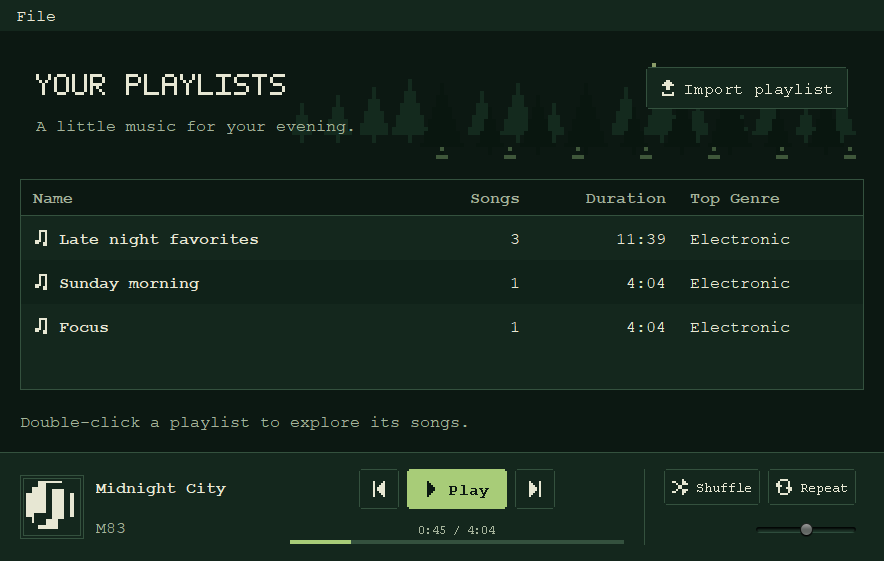
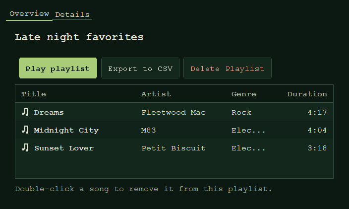
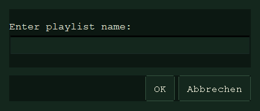

# Forest-Pixel-Theme

Die Gestaltung setzt die bestätigte Richtung für [Issue #15](https://github.com/ThatsMeGIT/music_playlist_shuffler/issues/15) um: dunkel, minimalistisch, Waldgrün und Pixel-Art. Sie greift die musikalischen Motive aus `MusicPlaylistShufflerLogo.png` und `SongCover.png` auf. Die Originalbilder bleiben erhalten; die Oberfläche zeichnet passende Motive direkt mit Swing/AWT.

## Vorschauen

Die folgenden Bilder zeigen die tatsächlichen Swing-Komponenten mit temporären Beispieldaten, ohne native Fensterrahmen:







Der bestätigte [Designentwurf](../../../../../docs/ui/forest-concept.png) ist eine mit Imagegen erzeugte Konzeptgrafik, kein Screenshot der Anwendung. Die Implementierung übernimmt Palette, Pixelmotive, Waldatmosphäre und die Anordnung der Playergruppen. Native Titelleisten werden vom Betriebssystem gezeichnet; ihre Gestaltung bleibt systemabhängig.

## Zuständigkeiten

| Klasse | Verantwortung |
|---|---|
| `UiStyle` | Palette, Schriften, Abstände, globale Swing-Defaults, wiederverwendbare Komponentenstile |
| `PixelHeading` | Bitmap-Buchstaben für kurze, feste Markenüberschriften |
| `ForestHeader` | Dezente Waldsilhouetten, Mond und Lichtreflexe auf einem festen Raster |
| `PixelIcon` | Note, Songcover und Symbole für Wiedergabe, Navigation, Modi und Import |
| `PixelButtonUi` | Flache Buttons mit gestuften Ecken und erkennbaren Interaktionszuständen |
| `PixelProgressUi` | Zeittext und schmale Fortschrittslinie |
| `PixelTabsUi` | Flache Tabs mit Unterstreichung des aktiven Tabs |
| `PixelScrollBarUi` | Dunkle Scrollbars mit erhaltener Pfeil-, Drag-, Tastatur- und Radbedienung |
| `MainFrame` | Waldkopf, Importaktion, Playlist-Tabelle und Bedienhinweis |
| `PlaybackControlPanel` | Songinformationen, Playergruppen, Darstellung des Modellzustands |
| `PlaylistDialog` | Metadaten, Aktionen, Songübersicht und Statistik |
| `MenuBar` | Dateimenü mit flacher, dunkler Gestaltung |

Gestaltung und Darstellung gehören ins UI-Paket. Modelllogik, Dateioperationen und Formate bleiben außerhalb der Styling-Klassen.

## Installation und Lebenszyklus

Der Anwendungseinstieg installiert den Stil einmal im Event Dispatch Thread (EDT), **vor** dem ersten Fenster oder Hinweisdialog:

```java
SwingUtilities.invokeLater(() -> {
    UiStyle.install();
    new MainFrame(player, path, saveAllowed);
});
```

`UiStyle.install()` ist für den Einstieg aus dem übergeordneten Paket öffentlich. Alle Komponenten, die über einen separaten Starter erzeugt werden, benötigen denselben vorherigen Aufruf. Ein Themewechsel während einer laufenden Sitzung ist nicht implementiert.

Als Grundlage wird das mit Java gelieferte Nimbus-Look-and-feel verwendet. Ist es nicht verfügbar oder kann es nicht geladen werden, bleibt das aktuelle Look-and-feel erhalten. Die explizit gesetzten Anwendungsstile bleiben nutzbar; generische Dialogdetails können dann abweichen.

Die Installation setzt globale `UIManager`-Werte für Flächen, Texte, Auswahl, Fokus und Formulare. `ButtonUI` und `ToggleButtonUI` verweisen auf `PixelButtonUi`, damit auch Standard-Swing-Dialoge flache Buttons erhalten. Deshalb ist diese Klasse öffentlich und bietet die von Swing benötigte statische Fabrik `createUI(JComponent)`. Anwendungsbuttons werden zusätzlich über `UiStyle.button()` gestaltet.

## Palette

Alle Anwendungsfarben werden zentral in `UiStyle` definiert. Neue Komponenten verwenden die Konstanten statt eigener Hexwerte.

| Konstante | Wert | Einsatz |
|---|---|---|
| `BACKGROUND` | `#0C1812` | Fast schwarzes Waldgrün für Fenster und Bibliothek |
| `SURFACE` | `#14271D` | Tabellen, Playerleiste, Buttons und Statistik |
| `TEXT` | `#E7E7D3` | Cremefarbener Haupttext |
| `MUTED` | `#A5B39B` | Hinweise, Künstler, Zeit und sekundäre Beschriftungen |
| `ACCENT` | `#A8CC78` | Blattgrün für primäre Aktionen, Fokus und Fortschritt |
| `BORDER` | `#34513E` | Ruhige Konturen und Trennlinien |
| `ALTERNATE_ROW` | `#102219` | Jede zweite Tabellenzeile |
| `SELECTION` | `#20382B` | Tabellenauswahl und Hover-Flächen |
| `DANGER` | `#E5A18C` | Lesbare warme Beschriftung der Löschaktion |

Auf hellgrünen Aktionsflächen wird `BACKGROUND` als Textfarbe verwendet. Auswahl und Fokus besitzen zusätzlich Konturen oder Unterstreichungen; die Bedeutung einer Aktion bleibt auch aus der Beschriftung bzw. dem zugänglichen Namen erkennbar.

Die dekorative Waldszene benutzt wenige zusätzliche, dunkle Grüntöne. Sie bleiben lokal in `ForestHeader`, weil sie keine Zustände oder Bedienelemente codieren. Ihre geringe Helligkeit hält die Textflächen im Vordergrund.

## Schriften und Raster

| Wert | Größe | Verwendung |
|---|---|---|
| `BODY_FONT` | Logische Java-Schrift `Monospaced`, 16 | Tabellen, Texte, Buttons, Menüs und Formulare |
| Bitmap-Überschrift | 5 × 7 Zellen pro Buchstabe, Faktor 3 | „Your playlists“ |
| Playlist-Überschrift | 22, fett | Frei eingegebener Playlist-Name |
| Songtitel | 16, fett | Aktueller Song |
| Kompakte Modusbuttons | 14 | Shuffle/Repeat |
| Zeit | 12 | Zeitdarstellung |
| `GAP` | 12 | Standardabstand zwischen Gruppen |
| `PADDING` | 20 | Bibliothek und Playerleiste |
| `ROW_HEIGHT` | 36 | Songtabellen und Tabellenkopf |
| Playlist-Zeilen | 44 | Größere Zeilen in der Hauptansicht |
| Normale Button-Innenabstände | 10 vertikal / 14 horizontal | Einheitliche Aktionsfläche |
| Wald-Raster | 4 | Scharfe, bewusst gestufte Silhouetten |

Die Größen sind Swing-Koordinaten. Die Betriebssystem-Skalierung wirkt auf die tatsächliche Darstellung. `Monospaced` wird von Java auf eine lokale Schrift abgebildet; es wird keine Schriftdatei oder zusätzliche Abhängigkeit benötigt.

`PixelHeading` zeichnet feste englische Überschriften mit einem 5×7-Alphabet A–Z und Leerzeichen. Es stellt sie in Großbuchstaben dar. Nicht unterstützte Zeichen erhalten ein Fragezeichen. **Nicht für frei eingegebene Namen oder übersetzte Texte verwenden.** Playlist-Namen, Titel und Künstler bleiben normale Swing-Texte, damit Unicode, Ellipsen und Tooltips funktionieren. Als `JLabel` behält die Bitmap-Überschrift ihren Text und zugänglichen Namen.

## Pixelmotive und Atmosphäre

`PixelIcon` zeichnet kleine Zeichen aus binären Zellmustern mit ganzzahligen Rechtecken. Es gibt keine Emoji-Abhängigkeit und keine geglätteten Bildvergrößerungen. Reguläre Symbole verwenden ein 8×8-Muster; der 64-Pixel-Songcover kombiniert eine gestufte cremefarbene Fläche, eine Note und doppelte Konturen.

Die Musiknote verbindet die Markenüberschrift des Entwurfs, Tabellen und Songcover. Die Anwendung verwendet weiterhin das vorhandene App-Logo als natives Fenstersymbol.

`ForestHeader.paintComponent()` zeichnet mehrere Baumreihen, eine kleine Mondsichel und dezente Reflexe. Die Motive skalieren über die verfügbare Breite auf einem festen Raster. Sie benötigen keine Ressourcen, Netzwerkzugriffe, Zufallszahlen oder Timer. Der Wald ist dekorativ und erhält keinen Tastaturfokus.

Keine Farbverläufe, Glasflächen, großen Schatten, runden Karten oder blinkenden Animationen ergänzen. Atmosphäre entsteht durch die Palette, kleine Pixelmotive und zurückhaltende Landschaftsdetails.

## Komponentenhilfen

| Methode | Wirkung |
|---|---|
| `panel(layout, background)` | Panel mit explizitem Layout und Hintergrund |
| `heading(text, size)` | Normale, fette Swing-Überschrift für beliebige Texte |
| `secondary(text)` | Monospace-Hinweis in der sekundären Farbe |
| `button(button, tooltip, primary)` | Pixel-UI, Abstände, Farben, Tooltip und zugängliche Beschriftung |
| `table(table, rightAlignedColumns...)` | Tabellenrenderer, Kopf, Scrollbereich und dunkle Scrollbars |

```java
JButton importButton = new JButton("Import playlist");
importButton.setActionCommand("addPlaylist");
importButton.addActionListener(actionHandler);
importButton.setIcon(new PixelIcon(PixelIcon.Kind.IMPORT, 16));
UiStyle.button(importButton, "Import a playlist from a CSV file", false);
```

Die Hilfsmethoden verbinden keine Listener und ändern keine Modelle. Eine primäre Aktion erhält `pixel.primary = true`, Blattgrün als Fläche und dunklen Text. Sekundäre Buttons besitzen eine Waldgrün-Fläche und eine dezente Kontur.

`PixelButtonUi` unterscheidet normal, Hover, gedrückt, ausgewählt, deaktiviert und Tastaturfokus. Die Ecken sind um zwei Koordinateneinheiten gestuft. Ausgewählte Togglebuttons bekommen dieselbe Akzentfläche wie primäre Aktionen; gedrückte Buttons eine gedämpfte Fläche. Deaktivierte Beschriftungen und Symbole werden zurückgenommen. Fokus wird als gestrichelte Kontur gezeichnet.

```java
JTable songTable = new JTable(data, columnNames);
songTable.getColumnModel().getColumn(3).setMinWidth(112);
JScrollPane scrollPane = UiStyle.table(songTable, 3);
panel.add(scrollPane, BorderLayout.CENTER);
```

Die Ausrichtungsparameter sind **Modellspalten**, keine sichtbaren Spaltenpositionen. Auch nach dem Verschieben einer Spalte bleiben Dauer und Songanzahl rechts ausgerichtet. Die Breiten bestimmt das jeweilige Fenster. Die Dauer-Spalte der Songtabelle besitzt eine Mindestbreite von 112.

Der `Object`-Renderer zeigt in der ersten Modellspalte eine Note und fette Schrift. Andere Spalten bleiben ohne Symbol; die Renderer setzen Zustand, Farbe, Schrift, Rahmen und Symbol bei jedem Aufruf neu. Die Auswahl ist moosgrün, der Zellfokus besitzt eine Akzentkontur. Es gibt 12 Pixel horizontalen Textabstand sowie abwechselnde dunkle Zeilenflächen.

Der eigene Kopf-Renderer zeigt keine Sortiersymbole. Diese Überarbeitung aktiviert keinen Sortierer. Wenn später sortierbare Tabellen oder spezielle Spaltentypen ergänzt werden, deren Renderer und Kopfhinweise gemeinsam prüfen.

## Fenster und Playerleiste

Die Hauptansicht behält **900 × 600** als Mindestgröße. Der Waldkopf verbindet die Bitmap-Überschrift und einen kurzen atmosphärischen Text mit der rechts platzierten Importaktion. Unter der Tabelle erklärt ein Bedienhinweis den Doppelklick.

Die Playerleiste verwendet drei horizontale Gruppen:

1. Links: 64-Pixel-Cover, Songtitel und Künstler. Lange Metadaten dürfen zugunsten der Bedienelemente gekürzt werden; Tooltips zeigen den vollständigen Text.
2. Mitte: Previous, Play/Pause und Next sowie Zeit und Fortschrittslinie. Die Navigation verwendet Symbole, Play/Pause zusätzlich eine sichtbare Beschriftung.
3. Rechts: Shuffle/Repeat und der bestehende Lautstärke-Vorschauregler, durch eine dezente vertikale Linie abgesetzt.

Die Gruppen erhalten begrenzte bevorzugte Breiten, damit lange Titel nicht die Navigation verdrängen. Der Fortschritt ist weiterhin ein nicht bedienbarer Anzeigeindikator. `PixelProgressUi` zeichnet die Blattgrün-Linie ausdrücklich auch im deaktivierten Zustand.

Der Playlist-Dialog startet mit **720 × 460**, seine Mindestgröße bleibt **600 × 420**. Name und optionale Beschreibung stehen vor den Aktionen. „Play playlist“ ist primär, Export und Löschen sind sekundär. Die Löschaktion besitzt eine warme Textfarbe. Songtabelle und Statistik verwenden dieselben Flächen und Schriftregeln wie die Hauptansicht.

Tabs besitzen eine grüne Unterstreichung für den aktiven Tab und eine eigene Tastaturfokus-Kontur. Dateiauswahl, Eingaben und Meldungen behalten ihre Swing-Abläufe und übernehmen die globalen Theme-Werte.

## Zustände und Zugänglichkeit

- Play/Pause entspricht dem Playerstatus; Text, Symbol, Tooltip, zugänglicher Name und Beschreibung werden gemeinsam aktualisiert.
- Shuffle und Repeat zeigen den Zustand der aktiven Playlist mit `JToggleButton`; es gibt keine separate Zustandskopie im Theme.
- Symbolbuttons behalten Tooltips und zugängliche Namen. `UiStyle.button()` nutzt bei leerer sichtbarer Beschriftung den erklärenden Tooltip als zugänglichen Namen.
- Buttons bleiben fokussierbar; Tabulator und Leertaste sowie Menünavigation werden nicht abgeschaltet.
- Tabellen zeigen Auswahl und Zellfokus getrennt. Die Scrollbars behalten Standardnavigation und Pfeilbuttons.
- Ohne Song bleiben Hinweis und Zeit „0:00 / 0:00“ lesbar.
- Die Lautstärke bleibt eine Vorschau ohne Audiofunktion; Tooltip und zugänglicher Name benennen dies.
- Keine Modell-, CSV-, JSON-, Shuffle-, Navigations- oder Speicherlogik gehört in Renderer oder Painter.

## Prüfen und erweitern

Gezielte und vollständige Prüfung:

```text
mvn "-Dtest=PlaybackControlPanelTest" test
mvn --batch-mode --no-transfer-progress clean verify -DfailIfNoTests=true
```

`PlaybackControlPanelTest` prüft leere Zustände, das Entfernen der aktiven Playlist, die statusabhängige Beschriftung, zugängliche Namen der Symbolnavigation sowie die Platzierung bei geringer Breite und langen Metadaten.

Für visuelle Prüfungen einen temporären Player und Speicherpfad verwenden. Der normale Einstieg speichert beim Schließen nach `src/main/resources/test.json`. Die Dokumentationsbilder entstehen mit isolierten Beispieldaten; sie sind keine bearbeiteten Screenshots des Benutzerdatenbestands.

Bei Änderungen prüfen:

- Hauptansicht bei 900 × 600 und größer, beide Dialogtabs bei 600 × 420 und größer.
- Lange und internationale Namen, leere Playlist, kein aktiver Song.
- Ausgewählte Zeilen, verschobene Spalten, Fokus, Hover, gedrückte und aktive Modusbuttons.
- Play/Pause, Next/Previous und Shuffle/Repeat mit konsistentem Modellzustand.
- Eingabedialog, Fehlermeldung und Dateiauswahl: dunkle Flächen und lesbarer Text.
- Tastaturbedienung und verschiedene Bildschirm-Skalierungen.
- Native Rahmen und Standarddialoge auf den unterstützten Plattformen.

Gerenderte Ansichten und automatisierte Tests ersetzen keine vollständige Prüfung assistiver Technologien, nativer Dateiauswahl oder aller Betriebssysteme und DPI-Stufen. Zusätzliche Stile zentral ergänzen und ihre Regeln hier dokumentieren. Live-Themewechsel, neue Musikfunktionen und ein Ersatz für den bestehenden „Add Song“-Platzhalter sind separate Aufgaben.
